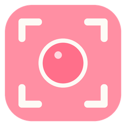
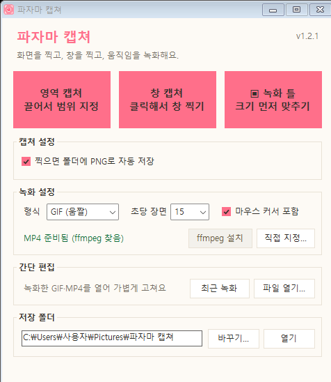

  

<h1 align="center">파자마캡쳐 (PajamaCapture)</h1>

  화면을 찍고, 창을 찍고, 움직임을 <b>GIF·MP4로 녹화</b>하는 윈도우 프로그램이에요. 
  <b>녹화 틀</b>을 먼저 띄워 크기를 맞춰 놓고 녹화하고, 녹화한 파일은 <b>간단 편집</b>으로 바로 고쳐요.

  
  
  

  

---

## ⬇️ 받기

  <a href="https://github.com/hwangjinwook/PajamaCapture/releases/latest"><b>👉 최신 버전 받으러 가기 (Releases)</b></a>

<table>
<tr><th nowrap>파일</th><th>설명</th></tr>
<tr><td nowrap><code>파자마캡쳐.exe</code></td><td>프로그램 본체</td></tr>
<tr><td nowrap><code>README_사용설명서.txt</code></td><td>이 페이지와 같은 사용법</td></tr>
</table>

## 🚀 실행하기

1. 위 링크의 **Assets** 에서 `PajamaCapture_v버전.zip` 을 받아요.
2. 원하는 폴더에 **압축을 풀어요.** zip 창 안에서 바로 실행하면 임시 폴더에서 열려 다음에 찾기 어려워요.
3. `파자마캡쳐` 폴더의 `파자마캡쳐.exe` 를 실행해요. 이미 켜져 있으면 켜져 있던 창이 앞으로 나와요.

> 설치할 것은 없어요. 윈도우 10·11 에 기본으로 들어 있는 .NET Framework 4.x 로 실행돼요. 
> MP4 녹화와 MP4 크기 바꾸기에만 무료 프로그램 ffmpeg 가 필요해요(아래 「🎬 MP4 준비」 참고). 
> 「Windows의 PC 보호」 창이 뜨면 「추가 정보」 → 「실행」을 누르세요(디지털 서명이 없는 프로그램이라 나오는 안내예요).

## 📝 사용법

<table>
<tr><th nowrap>하고 싶은 일</th><th>방법</th></tr>
<tr><td nowrap>영역 캡쳐</td><td><b>영역 캡쳐</b> → 끌어서 범위 정하기(창 위에서 클릭만 하면 그 창 범위) → <code>Enter</code> 로 복사</td></tr>
<tr><td nowrap>범위 고치기</td><td>분홍 손잡이를 끌어 크기, 범위 안쪽을 끌어 위치. 화살표 1점 이동, <code>Shift</code>+화살표 1점 크기</td></tr>
<tr><td nowrap>저장하며 찍기</td><td>범위를 정한 뒤 <b>저장…</b> → 위치·이름·형식(PNG·JPG·BMP) 고르기</td></tr>
<tr><td nowrap>창 캡쳐</td><td><b>창 캡쳐</b> → 찍을 창을 클릭(바탕 화면을 누르면 그 모니터 전체)</td></tr>
<tr><td nowrap>끌어서 바로 녹화</td><td><b>영역 캡쳐</b> → 범위를 끌거나 창을 클릭 → 도구 막대의 <b>● 녹화</b> → 녹화 막대의 <b>■ 정지</b></td></tr>
<tr><td nowrap>틀 띄우고 녹화</td><td><b>▣ 녹화 틀</b> → 틀을 옮기고 크기 맞추기 → 막대의 <b>● 녹화</b> → <b>■ 정지</b></td></tr>
<tr><td nowrap>녹화 설정</td><td>형식(GIF·MP4), 초당 장면(10·15·20·30), 마우스 커서 포함</td></tr>
<tr><td nowrap>녹화 고치기</td><td>녹화 알림의 <b>편집하기</b>, 메인 창 <b>최근 녹화</b>·<b>파일 열기…</b>, 또는 GIF·MP4 를 메인 창에 끌어다 놓기</td></tr>
<tr><td nowrap>GIF 편집</td><td>짝수·홀수 프레임 솎기, 프레임 삭제, 프레임 시간, 캔버스 크기, 영역 잘라내기, 되돌리기(<code>Ctrl+Z</code>), 저장(<code>Ctrl+S</code>)</td></tr>
<tr><td nowrap>MP4 크기 바꾸기</td><td>가로·세로(해상도)만 바꿔 새 MP4 로 저장(짝수 크기로 맞춤)</td></tr>
<tr><td nowrap>취소</td><td><code>Esc</code> 또는 오른쪽 클릭</td></tr>
</table>

## 🎬 MP4 준비 (ffmpeg)

둘 중 하나만 하면 돼요. 준비가 끝나면 프로그램에 **「MP4 준비됨」** 이 표시돼요.

- **가장 쉬운 방법:** 프로그램의 **ffmpeg 설치** 단추를 눌러요. 명령 창이 열려 설치가 진행돼요(`winget install -e --id Gyan.FFmpeg`). 끝나면 그 창을 닫고 파자마캡쳐 창으로 돌아오면 자동으로 다시 찾아요.
- **직접 받기:** [ffmpeg 내려받기 페이지](https://www.gyan.dev/ffmpeg/builds/)에서 `ffmpeg-release-essentials.zip` 을 받아 압축을 풀고, 그 안의 `bin\ffmpeg.exe` 를 `파자마캡쳐.exe` 옆에 두거나 **직접 지정…** 으로 골라요.

## 💾 저장 위치

- 찍은 그림과 녹화는 **저장 폴더**(기본 `사진\파자마 캡쳐`)에 `파자마캡쳐_날짜_시각.png / .gif / .mp4` 로 저장돼요. 메인 창에서 바꾸거나 바로 열 수 있어요.
- 설정은 `%APPDATA%\PajamaCapture\settings.ini` 에 저장돼요. 프로그램 폴더를 옮기거나 지워도 남아요.
- 지우려면 `파자마캡쳐` 폴더를 지우면 돼요. 설정까지 지우려면 `%APPDATA%\PajamaCapture` 도 지우세요.

## 🔄 새 버전으로 바꾸기

켜 둔 파자마캡쳐를 끄고, 새 zip 의 `파자마캡쳐.exe` 로 바꿔 넣으면 돼요. 설정은 그대로 이어져요.

## 📜 버전 기록

<table>
<tr><th nowrap>버전</th><th nowrap>배포일</th><th>내용</th></tr>
<tr><td nowrap><b>v1.2.1</b></td><td nowrap>2026-11-27</td><td>메인 창의 「● 녹화(끌어서 범위)」 버튼을 뺌 — 같은 일은 <b>영역 캡쳐</b> 도구 막대의 <b>● 녹화</b>로 해요</td></tr>
<tr><td nowrap>v1.2.0</td><td nowrap>2026-11-27</td><td>🖼 녹화 틀(꿀캠 방식) — 틀을 먼저 띄워 옮기고 크기를 맞춘 뒤 녹화 크기 표시·정해진 크기 메뉴, 녹화 중 크기 잠금, MP4 는 짝수 크기로</td></tr>
<tr><td nowrap>v1.1.0</td><td nowrap>2026-11-08</td><td>✂️ 간단 편집 — GIF 프레임 솎기·삭제·시간·캔버스 크기·영역 잘라내기, MP4 크기 바꾸기</td></tr>
<tr><td nowrap>v1.0.1</td><td nowrap>2026-11-07</td><td>찍기 전 기다림(타이머) 설정을 빼고, 창 오른쪽 위에 버전 표시</td></tr>
<tr><td nowrap>v1.0.0</td><td nowrap>2026-11-07</td><td>첫 버전 — 영역 캡쳐·창 캡쳐·GIF/MP4 녹화</td></tr>
</table>

---

🛠 직접 빌드하기

`build.cmd` 를 실행하면 윈도우에 기본으로 있는 C# 컴파일러로 `파자마캡쳐.exe` 를 만들어요(설치할 것 없음). 시험은 `tests\run-tests.cmd` 예요.
파일 구성, 시험 내용, 기능별 자세한 설명은 [docs/DEVELOPMENT.md](docs/DEVELOPMENT.md) 에 있어요.

